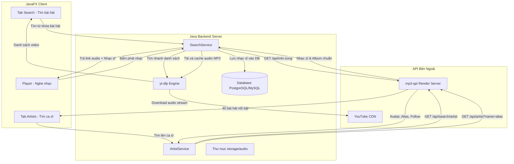

# Hướng dẫn Tích hợp API Zing MP3 vào Hệ thống Music Finder

Tài liệu này liệt kê **các API trọng tâm được tích hợp trực tiếp vào hệ thống Java Backend (`LTUDM-NHOM01`)**, phục vụ cho các chức năng: Tìm kiếm bài hát, Tìm kiếm ca sĩ, Bổ sung Nhạc sĩ & Lyric, và Bảng xếp hạng thịnh hành.

* **Base URL (Render Production):** `https://mp3-api-f60g.onrender.com`
* **Localhost (Dev):** `http://localhost:5555`

---

## Bảng ánh xạ API vào các Service trong Java

| Chức năng trong App | Service Java phụ trách | Endpoint API Render | Mục đích sử dụng |
| :--- | :--- | :--- | :--- |
| **1. Tìm kiếm Bài hát** | `SearchService.java` | `GET /api/search/song` | Tìm bài hát sạch sẽ, không bị lẫn nghệ sĩ |
| **2. Bổ sung Nhạc sĩ & Album** | `SearchService.java` | `GET /api/info-song` | Lấy tên Nhạc sĩ (`composers`) và Album chuẩn |
| **3. Lời bài hát (Karaoke/Lyric)** | `SearchService.java` | `GET /api/lyric` | Lấy file `.lrc` có timestamp đồng bộ câu hát |
| **4. Tìm kiếm Nghệ sĩ** | `ArtistService.java` | `GET /api/search/artist` | Tìm ca sĩ theo tên tiếng Việt, lấy `alias` & Avatar |
| **5. Hồ sơ Ca sĩ & DS Bài hát** | `ArtistService.java` | `GET /api/artist` | Lấy tiểu sử, số follow và **40 bài hát nổi bật** |
| **6. Bảng xếp hạng (Trending)** | `StatisticsService.java` | `GET /api/chart-home` | Lấy danh sách bài hát đang hot nhất thịnh hành |
| **7. Top 100 theo thể loại** | `PlaylistService.java` | `GET /api/top100` | Gợi ý danh sách bài hát theo thể loại nhạc |

---

## Chi tiết các Endpoint tích hợp

### 1. Tìm kiếm Bài hát riêng biệt (Dùng cho Tab Search)
API chỉ trả về danh sách bài hát, không trả về nghệ sĩ hay video.

* **Endpoint:** `GET /api/search/song`
* **Tham số:**
  * `q` *(string, bắt buộc)*: Tên bài hát cần tìm.
* **Ví dụ:**
  ```text
  GET https://mp3-api-f60g.onrender.com/api/search/song?q=lạc trôi
  ```
* **Dữ liệu trả về (JSON):**
  ```json
  {
    "err": 0,
    "msg": "Success",
    "data": {
      "total": 9,
      "songs": [
        {
          "encodeId": "qYD31k5TVTCQ",
          "title": "Lạc Trôi",
          "artistsNames": "Sơn Tùng M-TP",
          "duration": 233,
          "thumbnail": "https://photo-resize-zmp3.zmdcdn.me/...jpg",
          "hasLyric": true
        }
      ]
    }
  }
  ```

---

### 2. Lấy Nhạc sĩ sáng tác & Album (Dùng khi người dùng bấm phát bài hát)
YouTube không có trường nhạc sĩ chuẩn, API này dùng để bổ sung trường `composer` vào database khi bài hát được click.

* **Endpoint:** `GET /api/info-song`
* **Tham số:**
  * `id` *(string, bắt buộc)*: `encodeId` của bài hát (ví dụ: `qYD31k5TVTCQ`).
* **Ví dụ:**
  ```text
  GET https://mp3-api-f60g.onrender.com/api/info-song?id=qYD31k5TVTCQ
  ```
* **Dữ liệu trích xuất chính:**
  ```json
  {
    "err": 0,
    "data": {
      "encodeId": "qYD31k5TVTCQ",
      "title": "Lạc Trôi",
      "artistsNames": "Sơn Tùng M-TP",
      "composers": [
        {
          "id": "QNUhZaW1CnPC",
          "name": "Sơn Tùng M-TP",
          "alias": "Son-Tung-M-TP"
        }
      ],
      "album": {
        "title": "Lạc Trôi (Single)",
        "releaseDate": "31/12/2016"
      },
      "genres": [
        { "name": "V-Pop" }
      ]
    }
  }
  ```

---

### 3. Lời bài hát (Dùng cho tính năng Lyrics / Karaoke)
* **Endpoint:** `GET /api/lyric`
* **Tham số:**
  * `id` *(string, bắt buộc)*: `encodeId` của bài hát.
* **Ví dụ:**
  ```text
  GET https://mp3-api-f60g.onrender.com/api/lyric?id=qYD31k5TVTCQ
  ```
* **Dữ liệu trả về (JSON):**
  * `data.file`: Link tải file `.lrc` chuẩn có timestamp.
  * `data.sentences`: Mảng các câu hát kèm mốc thời gian `startTime`, `endTime` (miligiây) để cuộn lời đồng bộ theo nhạc.

---

### 4. Tìm kiếm Nghệ sĩ riêng biệt (Dùng cho Tab Artists)
Người dùng chỉ cần gõ tên tiếng Việt bình thường (ví dụ: `"sơn tùng"`, `"hà anh tuấn"`), API sẽ trả về danh sách ca sĩ kèm mã `alias` và `id` chuẩn để tra cứu tiếp.

* **Endpoint:** `GET /api/search/artist`
* **Tham số:**
  * `q` *(string, bắt buộc)*: Tên ca sĩ / nghệ sĩ.
* **Ví dụ:**
  ```text
  GET https://mp3-api-f60g.onrender.com/api/search/artist?q=sơn tùng
  ```
* **Dữ liệu trả về (JSON):**
  ```json
  {
    "err": 0,
    "msg": "Success",
    "data": {
      "total": 7,
      "artists": [
        {
          "id": "QNUhZaW1CnPC",
          "name": "Sơn Tùng M-TP",
          "alias": "Son-Tung-M-TP",
          "thumbnail": "https://photo-resize-zmp3.zmdcdn.me/...jpg",
          "totalFollow": 2660784
        }
      ]
    }
  }
  ```

---

### 5. Xem Hồ sơ Ca sĩ & 40 Bài hát nổi bật (Dùng cho `ArtistService.java`)
Lấy toàn bộ thông tin chi tiết của ca sĩ theo `alias` (đã lấy được từ bước 4). Toàn bộ danh sách bài hát nổi bật nhất của ca sĩ nằm sẵn trong `data.sections[0].items`.

* **Endpoint:** `GET /api/artist`
* **Tham số:**
  * `name` *(string, bắt buộc)*: `alias` của ca sĩ (ví dụ: `Son-Tung-M-TP`, `Ha-Anh-Tuan`, `Den`).
* **Ví dụ:**
  ```text
  GET https://mp3-api-f60g.onrender.com/api/artist?name=Son-Tung-M-TP
  ```
* **Dữ liệu trích xuất chính:**
  * `data.name`: Tên nghệ sĩ (`Sơn Tùng M-TP`).
  * `data.biography`: Tiểu sử đầy đủ của nghệ sĩ.
  * `data.totalFollow`: Tổng số người hâm mộ theo dõi.
  * `data.sections[0].items`: **Toàn bộ 40 bài hát nổi bật** (Nơi Này Có Anh, Âm Thầm Bên Em, Lạc Trôi, Chạy Ngay Đi...).

---

### 6. Bảng xếp hạng ZingChart Realtime (Dùng cho Tab Trending)
Lấy top bài hát thịnh hành theo giờ tại Việt Nam để hiển thị lên màn hình Home / Trending của ứng dụng.

* **Endpoint:** `GET /api/chart-home`
* **Tham số:** Không có
* **Ví dụ:**
  ```text
  GET https://mp3-api-f60g.onrender.com/api/chart-home
  ```
* **Dữ liệu trả về:**
  * `data.RTChart.items`: Danh sách 100 bài hát xếp hạng theo thứ tự từ #1 đến #100.
  * Mỗi bài hát có sẵn: `encodeId`, `title`, `artistsNames`, `thumbnail`, `duration`.

---

### 7. Top 100 theo thể loại (Dùng cho Tab Khám phá)
* **Endpoint:** `GET /api/top100`
* **Tham số:** Không có
* **Ví dụ:**
  ```text
  GET https://mp3-api-f60g.onrender.com/api/top100
  ```
* **Dữ liệu trả về:** Danh mục các thể loại Top 100: V-Pop, Nhạc Trẻ, US-UK, K-Pop, Nhạc Không Lời... kèm danh sách bài hát thuộc top.

---

## Kiến trúc phối hợp giữa YouTube (`yt-dlp`) và Zing MP3 (`Render`)



> [!NOTE]
> * **Nguồn phát âm thanh:** Luôn để **`yt-dlp` (YouTube)** phụ trách vì YouTube hoạt động ổn định trên mọi máy chủ, không bị chặn bản quyền theo quốc gia.
> * **Nguồn Metadata (Nhạc sĩ, Ca sĩ, Lyric, Trending):** Lấy từ **Zing MP3 (Render API)** vì thông tin chuẩn hóa theo cấu trúc, sạch sẽ và không có từ rác.
